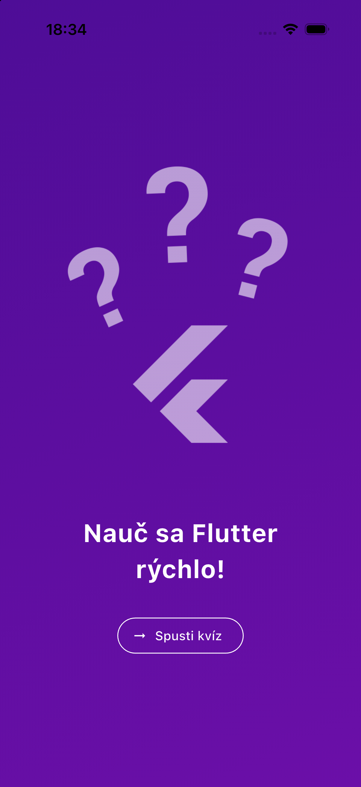
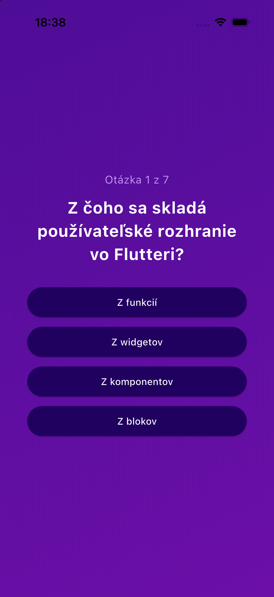
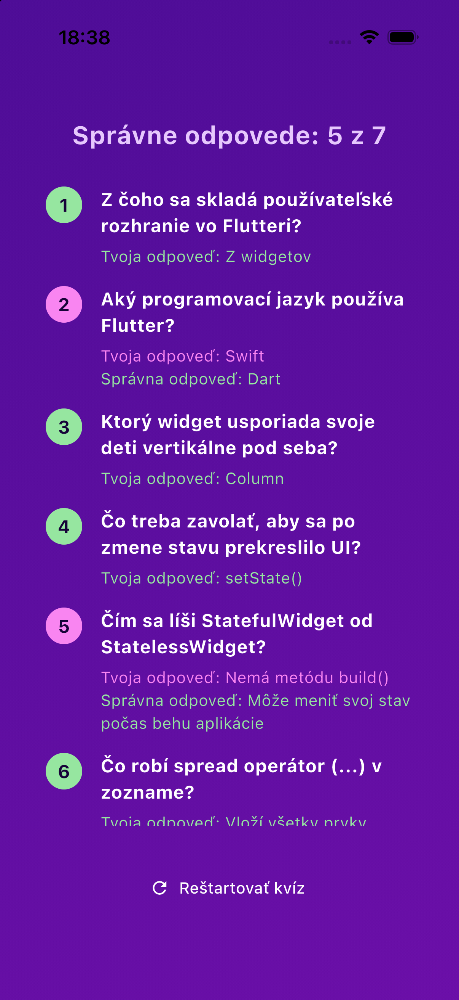

# Quiz App

Interaktívna kvízová aplikácia vo Flutteri – úvodná obrazovka, otázky s náhodne zamiešanými odpoveďami a prehľad výsledkov s možnosťou reštartu.

## Screenshoty (iOS simulátor, iPhone 17 Pro)

| Start Screen | Questions Screen | Results Screen |
| --- | --- | --- |
|  |  |  |

## Štruktúra

```
lib/
├── data/questions.dart        # zoznam otázok (prvá odpoveď je vždy správna)
├── models/
│   ├── answer_button.dart     # tlačidlo s odpoveďou
│   └── quiz_question.dart     # model otázky + shuffledAnswers
├── main.dart
├── quiz.dart                  # StatefulWidget, ktorý prepína obrazovky
├── start_screen.dart
├── questions_screen.dart
├── results_screen.dart
└── questions_summary.dart     # prehľad odpovedí na obrazovke výsledkov
```

## Spustenie

```
flutter pub get
flutter run
```
